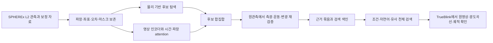

# SPHEREx Vision 계획 묶음

작성일: 2026-11-14. 상태: **구현 전 설계**. 사용자가 브레인스토밍과 설계 선택을 위임했으며, 이 문서는 그 결정과 검증 방법을 기록한다. 제품 코드, 학습 모델, 관측 결과를 새로 만든 것은 아니다.

목표는 **SPHEREx의 서로 다른 시각·파장에서 얻은 관측을 함께 읽고, 이동·변광·특이 스펙트럼 후보를 근거와 함께 검색하는 눈**을 만드는 것이다. 기존 TrueBlink를 관측 확인 화면으로 사용하고, Python 분석 엔진과 학습 모듈을 추가한다.

## 먼저 읽을 문서

| 문서 | 내용 |
|---|---|
| [설계서](superpowers/specs/2026-11-14-spherex-vision-design.md) | 요구사항, 자문자답, 논문 코드 활용, 모델 구조, 데이터 계약, 검색 경험 |
| [데이터·평가 계획](superpowers/specs/2026-11-14-spherex-vision-data-evaluation.md) | 실제 관측·주입 실험, 학습 분할, 지표, 단계별 통과 기준 |
| [구현 계획](superpowers/plans/2026-11-14-spherex-vision.md) | 파일별 책임, 함수 계약, 작업 순서, 테스트와 완료 조건 |
| [기존 앱 설계](ARCHITECTURE.md) | 브라우저 FITS·WCS·표시 모듈의 기존 계약 |

## 이번에 정한 방향

1. 첫 검색 흐름은 **좌표/천체명 → 분석된 영역 선택 → 이동·변광 후보 → 수치 조건/자연어로 좁히기 → 원관측 확인**이다. 관심 천체와 유사한 후보 검색도 지원한다.
2. 먼저 실제 자료로 물리 분석 기준선을 만든다. 다음으로 **공유 2D 영상 인코더 + 불규칙 시간·파장 attention + 후보 제안/임베딩**을 학습하고, 기준선과 후보를 합쳐 원관측에서 다시 측정한다.
3. 파장 차이가 시간 변화로 보이지 않도록 관측별 응답함수와 파장 지도를 보존한다. 시각화용 보간 영상과 과학 측정에 사용하는 원래 검출기 픽셀을 구분한다.
4. 자연어 모델은 검색 조건 해석과 근거 설명을 맡는다. 밝기·위치·속도·유의도는 측정 모듈이 계산한다. 설명 없이 모델 점수만 제시하지 않는다.
5. 첫 배포 범위는 미리 분석한 제한된 하늘 영역이다. 전체 하늘 검색, 실시간 전천 분석, 확정 궤도·질량·거리 추정은 후속 범위다.
6. 정적 웹 앱은 유지한다. 분석·학습·색인 생성은 로컬 Python 작업으로 수행하고, 검증된 JSON/영상 묶음을 앱에 제공한다. 초기 버전에 유료 모델이나 GPU 서버 운영을 필수로 두지 않는다.

## 실행 순서와 판단 지점

| 단계 | 결과물 | 다음 단계 조건 |
|---|---|---|
| P0 | 자료 계약, 실제 노출 고정 표본, 보정 가능성 보고서 | 파장·ePSF·분산·좌표를 검증 가능 |
| P1 | 물리 기준선, 후보 근거 묶음, 조건 검색 화면 | 실제 자료에서 재현 가능하고 잘못된 변화를 억제 |
| P2 | 학습 영상·시계열 인코더, 유사 검색 | 같은 오탐 예산에서 기준선보다 유효한 개선 |
| P3 | 선택적 VLM 설명, 자연어 조건 해석 | 수치 조건 보존과 근거 추적 검증 통과 |

수치 목표는 모두 **앞으로 검증할 설계 기준**이다. 네 논문에서 보고한 성능을 SPHEREx 성능으로 간주하지 않는다. 파장 보정 자료, 검증 표본, 연산 자원이 부족하면 그 단계의 완료 상태와 검색 범위를 명시한다.

작업 트리는 동시에 변경될 수 있다. 구현 시작 시 기존 모듈과 테스트 상태를 다시 조사하고, 이 계획의 새 파일만 있는 것으로 가정하지 않는다.
