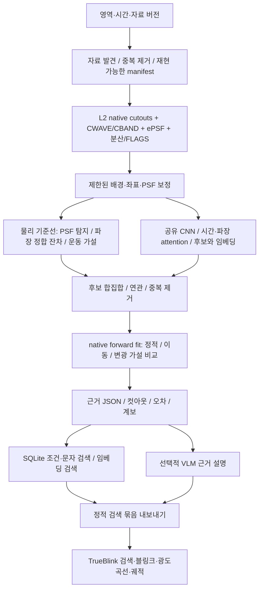

# SPHEREx Vision 설계서

작성일: 2026-11-14 · 상태: 구현 전 · 작업 위치: `trueblink/`.

이 설계는 사용자가 제공한 네 논문과 공개 구현, 로컬 SPHEREx 참조 프로젝트, 현재 TrueBlink를 조사해 작성했다. 사용자의 요청에 따라 질문의 답과 기본 설정은 설계자가 정했다. 아래 수치와 모델 크기는 검증 전 제안이며 관측 성능을 뜻하지 않는다.

연결 문서: [계획 개요](../../VISION_PLAN.md), [데이터·평가](2026-11-14-spherex-vision-data-evaluation.md), [구현 순서](../plans/2026-11-14-spherex-vision.md).

## 1. 사용자의 의도와 결과물

**관측 영상 속 공간 구조, 파장에 따른 밝기, 시간에 따른 이동·변화를 함께 이해하고 사용자가 원하는 천체 후보를 찾도록 돕는다.**

첫 사용자는 천문 관측을 탐색하는 연구자 또는 관심 있는 일반 사용자다. 복잡한 분석을 직접 설정하지 않아도 후보를 찾을 수 있고, 연구자는 사용한 노출과 측정 조건까지 추적할 수 있어야 한다.

| ID | 요구사항과 완료의 의미 |
|---|---|
| R1 | 좌표/천체명으로 영역을 선택하고 분석 범위·시각·파장·완료 상태를 확인한다. |
| R2 | 이동 후보, 정지 위치의 변광 후보, 스펙트럼 특이 후보를 각각 찾는다. 느린 이동체를 정적 배경으로 버리지 않는다. |
| R3 | 파장/PSF/배경/검출기 차이와 실제 천체 변화를 분리하고 불확실성을 출력한다. |
| R4 | 모든 후보에 원영상, 비교 자료, 잔차, 측광, 위치/운동, 품질 및 출처가 연결된다. |
| R5 | 구조화 조건, 자연어 조건, 예시 천체와의 유사도로 검색하며 수치 조건을 정확히 지킨다. |
| R6 | 학습 모델의 추가 효과를 같은 데이터·오탐 예산에서 물리 기준선과 비교한다. |
| R7 | 관측·보정·코드·설정·모델 버전으로 결과를 재현하고 부분 실패를 표시한다. |
| R8 | 기존 TrueBlink의 시각화와 좌표·단위 계약을 유지하면서 기능을 추가한다. |

첫 버전의 제외 범위: 전천 즉시 검색, 실제보다 높은 해상도라고 주장하는 생성 영상, 논문 모델 가중치의 무검증 전이, 신규 천체의 확정 판정, 빈약한 시계열로 궤도·거리·질량 결정. 이 기능들은 MVP의 성공 조건이 아니다.

## 2. 브레인스토밍: 질문과 결정

| 스스로 던진 질문 | 결정과 이유 |
|---|---|
| 눈의 기본 단위는 사진인가, 천체인가? | 타일에서 후보를 제안한 뒤 **천체/이벤트별 관측 집합**으로 판정한다. 영상 전체 맥락과 여러 노출의 증거가 모두 필요하다. |
| 일반 영상 AI를 그대로 사용할 수 있는가? | 직접 사용하지 않는다. SPHEREx는 불규칙한 시간과 위치별 파장을 가진 관측 집합이므로 시간·파장·불확실성을 입력에 넣는다. |
| 사용자에게 첫 입력으로 무엇을 받을 것인가? | 좌표나 천체명, 분석된 영역을 우선한다. 자연어는 그 영역의 후보를 좁히는 입력이다. 색인 밖까지 검색했다는 인상을 주지 않는다. |
| 먼저 찾아야 할 것은? | 이동과 변광을 P1의 핵심으로 한다. 스펙트럼 특이성은 비교 가능한 분광 표본이 갖춰진 영역부터 제공한다. |
| 모델이 놓친 후보는 어떻게 할 것인가? | 물리 기준선과 학습 제안의 **합집합**을 재검증한다. 학습 모델은 단순한 후처리 제거기가 아니다. |
| 대형 VLM이 최종 판정자인가? | 아니다. 측정된 근거를 설명하고 모호한 영상 형태를 검토한다. 실제/가짜 확률은 별도 검증 표본에서 보정한다. |
| 기존 웹 앱을 버릴 것인가? | TrueBlink를 검증 화면으로 확장한다. 무거운 분석과 학습은 Python에 둔다. |
| GPU나 유료 API가 없으면? | P1의 물리 분석·조건 검색은 작동한다. P2/P3는 별도 의존성으로 설치하며 미설치 상태를 명시한다. |
| 생성 모델은 어디에 쓰나? | 초기 핵심에서 제외한다. 이후 관측 제약을 만족하는 가설 비교 연구로만 검토한다. |
| 자동 결론을 신뢰할 수 없으면? | `insufficient_data`, `out_of_domain`, `unreviewed`를 실제 결과 상태로 사용한다. 억지로 천체 종류를 확정하지 않는다. |

검토한 대안은 ① VLM 중심 분류, ② 물리 분석만, ③ 물리 분석과 학습 인코더 결합이다. ①은 설명을 빨리 만들지만 미세 이동·측광·파장 정합을 보장하지 못한다. ②는 검증이 쉽지만 형태·복합 시계열 검색을 확장하기 어렵다. **③을 채택하되 ②를 먼저 완성해 비교 기준으로 남긴다.**

## 3. 논문과 실제 코드에서 가져오는 것

네 PDF의 본문·Methods·그림을 읽었고, 아래 공개 코드의 관련 경로를 확인했다. 논문 환경을 설치하거나 학습·추론을 재현하지는 않았다. 공개 데모와 논문의 전체 실험 재현은 구분한다.

| 논문 | 확인한 구현 | 채택하는 원리 | 직접 옮기지 않는 부분 |
|---|---|---|---|
| [Hezaveh et al., Nature 2017](https://www.nature.com/articles/nature23463) | [Ensai](https://github.com/yasharhezaveh/Ensai): `get_data.py`, `ensai_model.py` | 실제 PSF·잡음·마스크를 반영한 시뮬레이션, 빠른 CNN 추정, 여러 조건의 검증 | 강한 중력렌즈 SIE 5개 파라미터 출력과 기존 가중치. 타원률 대칭 손실을 운동 방향에 적용하면 안 된다. |
| [Stoppa et al., Nature Astronomy](https://www.nature.com/articles/s41550-025-02670-z) | [spacehack](https://github.com/turanbulmus/spacehack): 분류/평가 노트북, `helper_functions.py`의 `create_ex`, `preprocess`, 배치 호출 | science/reference/difference의 근거 패널, 소수 예제, 구조화된 설명과 전문가 평가 | 특정 Gemini 버전·Vertex 배치 의존성, 각 패널을 따로 정규화하는 표시, LLM 자체 평가를 검출 유의도로 사용하기 |
| [Ferrer Chávez et al., FLIP](https://www.nature.com/articles/s41586-026-11213-z) | [pyflip](https://github.com/rferrerc/pyflip/tree/submission): `model_classes.py`, `run_FLIP.py` | 미분 가능한 관측 모델, 먼저 보정한 뒤 천체를 적합하는 단계 구분, 주입 회수로 과적합 확인 | JWST 코로나그래프 Fourier 전파와 OPD 모델을 SPHEREx에 이식하기. SPHEREx에는 검증된 ePSF/픽셀 적분 모델을 사용한다. |
| [Lai et al., GenDIReCT](https://www.nature.com/articles/s41586-026-11241-9) | [paperM87 태그](https://github.com/samlaihei/GenDIReCT/tree/v1.1.0-paperM87): `runGenDIReCT.py`의 `runDiffusion`, `runCNN`, README | 학습된 제안 뒤 실제 관측과의 불일치를 줄이는 재검증, 여러 가설의 비교 | 간섭계 closure invariant, 절대 위치·플럭스 제거, EHT 가중치. SPHEREx에서 위치·절대 밝기는 보존해야 한다. |

확인 기준점:

- Ensai `master`: `1e555cd903afefba5c252bf464941669dfb3d45c`.
- spacehack `main`: `26cd3959b6ee585b31523642a5a45aa9405a59c3`.
- pyflip 코드 열람 기준 `submission`: `e0edc43a6e517925d9a98edc20edfc654c8db8e3`. 논문에서 가리킨 커밋 `a92e684fad6e8e516f59951223a362ae57dc2972`의 존재도 확인했으나 두 버전의 전 파일 동등성은 검사하지 않았다.
- GenDIReCT `v1.1.0-paperM87`: `11915017a6e22c5886d96b8d427f229c87f14445`. `main`은 `5523d570ec186158e8d13f2e92251215f822d2bf`. 논문 보관본은 [Zenodo](https://doi.org/10.5281/zenodo.22764433). README의 예시 학습 자료와 가중치만으로 Nature 실험 전체가 재현된다고 가정하지 않는다.
- spacehack은 Apache-2.0, GenDIReCT는 MIT 표기를 확인했다. Ensai/pyflip은 조사한 루트 목록에서 라이선스 파일을 확인하지 못했다. 이번 설계는 코드 복사를 요구하지 않는다. 향후 복사·배포하려면 해당 버전의 조건부터 확인한다.

로컬 `spherex-planet-x-main`의 검출·트랙 연결·주입 실험, `novax` 계열의 차분·PSF 적합도 검토했다. 사용 원리는 비교하되 기존 [TrueBlink 규칙](../../ARCHITECTURE.md)에 따라 참조 프로젝트의 코드·자산을 복사하지 않는다. 특히 정적 교차 일치 후보를 통째로 버리는 방식, 고정 빠른 속도 범위, 배경 제거 이후에만 주입하는 평가는 채택하지 않는다.

## 4. SPHEREx에 맞춰 지켜야 할 관측 계약

[공식 자료 구조](https://caltech-ipac.github.io/spherex-archive-documentation/spherex-data-products/)와 [접근 문서](https://caltech-ipac.github.io/spherex-archive-documentation/spherex-data-access/)를 2026-11-14에 확인했다. 당시 DR1/QR3가 제공되지만 운영 코드는 컬렉션과 처리 버전을 동적으로 조사한다.

1. **입력은 L2 노출 집합이다.** 각 노출의 시간, 검출기 좌표, 파장 지도, 대역 응답, PSF, 분산과 마스크를 함께 읽는다. 빈 시간·파장 칸을 보간해 실제 관측처럼 만들지 않는다.
2. 과학 측정은 full `CWAVE`/`CBAND` 보정과 필요 시 분광 응답함수에 연결한다. 작은 `WCS-WAVE` 표는 빠른 표시용이다. 채널 ID가 같다는 이유만으로 정확히 같은 파장이라고 간주하지 않는다.
3. L2 `IMAGE`의 ZODI는 사용 정책에 따라 한 번 제거한다. 이미 ZODI를 뺀 cube에 다시 적용하지 않는다. 처리 이력을 기록한다.
4. all-sky cube의 102면은 분광 채널이다. 시간 102개가 아니다. cube는 탐색 배경·보조 SED에 사용하고 시간 독립 기준 영상으로 자동 채택하지 않는다.
5. 헤더 `EXTNAME` 및 버전으로 HDU와 FLAGS를 찾는다. SOURCE/OUTLIER를 일괄 불량 처리하지 않는다. 과학·배경·표시 목적별 마스크 정책을 버전과 함께 기록한다.
6. ePSF는 원 검출기 위치·파장·서브픽셀 위치 및 픽셀 면적에 맞게 평가한다. 없을 때 Gaussian 근사는 미리보기만 허용하며 정밀 측정 완료 상태로 승격하지 않는다.
7. NaN/결측과 실제 0 또는 음의 측광값을 구별한다. 모델 텐서의 결측 채움은 별도 마스크와 함께만 허용하며 원자료를 바꾸지 않는다.
8. 표시 영상은 공통 하늘 격자로 재투영할 수 있다. 최종 측광·위치는 native pixel에서 적합한다. 재투영 잔차의 탐지 점수는 상관 잡음과 시행 횟수를 검증해야 한다.

현재 앱의 `Exposure`, `NativeCutout`, `SkyGrid`, `PhotPoint`를 재사용 가능한 경계로 삼는다. 단, **기존 `PhotPoint.flux`/`fluxErr`는 mJy이고 분석 결과는 µJy**이다. `toPhotPoint()`에서 1,000으로 나눠 변환하며 다른 메타데이터도 검증한다. 기존 `core/wave`의 표시용 보간 결과를 과학 보정으로 암묵적으로 승격하지 않는다.

## 5. 전체 구조와 실행 경계

- `vision/`에 독립 Python 패키지 `spherex_vision`를 둔다. CPU 기준선은 NumPy/SciPy/Astropy, 신경망은 선택적 PyTorch 의존성이다. Python 3.11 기준으로 구현 시작 때 실제 설치 검증 후 lockfile을 만든다.
- 기존 React/TypeScript/Vite 앱은 정적 배포를 유지한다. SIA 등 기존 릴레이와 대용량 분석 작업은 분리한다. 브라우저에 모델 API 키나 학습 코드를 넣지 않는다.
- 로컬 CLI에서 자료 수집→분석→색인→내보내기를 실행한다. 웹은 내보낸 소규모 색인과 근거를 읽는다. 자동 원격 분석 API/작업 큐는 초기 범위에 포함하지 않는다.
- 새 영역은 로컬 CLI 작업 후 추가된다. 웹에서 아직 분석하지 않은 영역은 `분석 자료 없음`으로 표시하고, 기존 아카이브 탐색은 가능하게 한다. 이를 `천체 없음`으로 표현하지 않는다.
- 기존 파일은 동시에 개발 중이다. 현재 타입과 FITS/WCS/시각화 파일의 존재만 확인했으며 앱 전체 실행 가능성을 이번 문서 작업에서 검증하지 않았다. 구현 T01에서 기존 상태를 다시 확인한다.

## 6. 물리 분석 기준선과 후보 재검증

관측 e의 픽셀 p에 대해 예측값을 다음처럼 정의한다.

`pred[e,p] = background[e,p] + time_average_over_exposure( pixel_average( PSF[e,lambda] * integral(response[e,p,lambda] * sky(position,t,lambda), d lambda) ) )`

자료의 표면밝기 단위와 응답함수 정규화를 맞춘 구현이어야 한다. 단순히 분광 플럭스를 더해서 MJy/sr에 대입하지 않는다. ePSF에 이미 포함된 픽셀 응답은 이중으로 적용하지 않는다.

주입·탐지 템플릿·최종 적합·학습 손실에 **같은 노출시간 적분 규칙**을 적용한다. 노출 동안 이동이 0.1 native pixel 미만이고 모델 플럭스 변화가 1% 미만이며, 기준 적분과의 차이가 0.1σ 미만임을 확인한 경우만 중앙시각 근사를 허용한다. 그 외에는 substep당 이동 ≤0.05 pixel, 플럭스 변화 ≤1%로 적응 적분한다. 4,096 substep을 넘으면 `unsupported_time_resolution`으로 남긴다. 실제 적분 가중치가 없으면 균일 시간 가중을 가정했다고 기록한다. 관측보다 짧은 flare 구조를 복원했다고 주장하지 않는다.

**보정 단계:** 안정적인 비교 천체와 빈 하늘에서 배경 평면, 작은 좌표 이동, 제한된 PSF 변화, 필요 시 광도 스케일을 추정한다. 타깃 영역을 제외하고 강한 prior와 범위를 둔다. 검증되지 않은 고차원 보정은 끈다. 후보 적합에서 보정 파라미터가 천체 신호를 흡수하지 않도록 고정하거나 보정 불확실성을 전파한다.

**제안 단계:** native PSF/matched-filter 탐지, 파장 정합 비교 잔차, 시간창별 이동 경로의 shift-and-stack을 사용한다. 초기 matched-filter 제안 문턱은 |SNR| ≥ 4이며 이는 최종 검출 유의도가 아니다. 양·음 잔차를 모두 기록한다. 낮은 단일 노출 SNR도 경로 적분에서 제안될 수 있다. 파라미터 탐색 범위와 시행 횟수를 기록한다.

**분기:** 짧은 시간 이동, 방문 간 느린 이동, 정지 위치의 변광, 스펙트럼 특이성을 별도로 계산한다. 후보는 여러 분기에 속할 수 있다. Gaia/SIMBAD/태양계 카탈로그 일치는 이름·기존 설명을 붙이는 정보이며 자동 제거 조건이 아니다.

**기준 영상:** leave-one-epoch-out으로 현재 평가할 노출 및 겹치는 데이터 기여를 제외한다. 같은 채널이라도 대역 응답 차이가 허용오차를 넘으면 단순 차분하지 않는다. 비교 천체로 검증된 SED 보정이 없으면 `incomparable_bandpass`를 출력한다. cube만 있는 경우 시간 변화 확증에는 쓰지 않는다.

### 6.1 응답군과 식별 가능한 가설

분광 응답을 적분값 1로 정규화했을 때 두 응답의 `integral(min(Ra,Rb)) ≥ 0.95`, 중심파장 차이 ≤ `0.1 × min(bandwidth)`인 노출만 같은 응답군의 후보로 묶는다. 이는 비교 가능성의 1차 검사다. 차분을 과학 근거로 사용하려면 아래 SED nuisance의 불확실성으로 예상되는 색 보정 오차의 3σ가 차분 측광 오차의 0.25배 이하인지도 확인한다. 실제 응답함수가 없으면 CWAVE/CBAND로 1차 선택까지만 하며 정밀 변광 확증은 보류한다.

각 좁은 응답군 g에서 SED는 `Sg(lambda)=fg+sg*(lambda-lambda0g)`로 두고 실제 응답에 적분한다. `fg,sg`는 전 시점이 공유하는 nuisance parameter이다. 높은 곡률/분광선 때문에 이 국소 선형 모델의 검증 잔차가 맞지 않으면 그 군은 P1 변광 확증에서 제외한다. 원 측광값은 그대로 보존한다.

- `H_static`: 고정 위치와 공유 `fg,sg`. 노출별 자유 플럭스로 정적 가설을 정의하지 않는다.
- `H_motion`: 같은 SED와 시간에 따른 위치. 단기/장기 운동 함수는 표의 범위를 따른다.
- `H_variable`: 고정 위치와 같은 SED에 시간 기저를 더한다. P1은 선형 추세, 1회 step, 추가 intrinsic-scatter 모델을 각각 시험한다. step 시각은 관측 사이 midpoint 중 양쪽에 독립 시점 ≥2개가 있는 후보로 제한한다. 임의 노출별 자유 플럭스 모델은 설명용 측광으로만 사용한다.
- `H_motion_variable`: 이동과 변광이 각각 지지된 후보에서 결합 가설을 비교한다. 결합 모델이 불안정하면 두 주장 중 지지되는 것만 남긴다.

추세/step 적합은 최소 독립 시점 3개, 유효 관측 수 ≥ 자유 파라미터 수+3, 정규화 설계행렬 full rank 및 condition number <10⁴를 요구한다. 시간·유효 파장의 절대 상관이 0.95를 넘으면 추가 독립 파장/시점 정보 없이는 `time_wavelength_degenerate`로 둔다. intrinsic scatter만 지지되면 변동성 후보로 표시하며 밝아짐/어두워짐 방향을 확정하지 않는다. 여러 기저·step·경로 탐색의 선택 효과는 전체 null 실험에서 보정한다.

최종 후보 연관은 단일 위치 근접만으로 합치지 않는다. 같은 분기에서 두 개 이상 공유 노출의 예측 위치가 합성 공분산에 대해 일치하는 경우를 우선 합치고, crossing track/서로 다른 이웃 광원은 별도 가설로 보존한다. 한 시점만 공유하면 확정 merge 대신 association ambiguity를 남긴다. tile padding은 최소 ePSF 지지 반경에 해당 시간창의 최대 예상 이동 거리를 더하고, 자료/예산 때문에 padding이 부족하면 해당 경계 coverage를 제외한다.

**최종 적합:** 후보 주변 이웃 천체를 함께 모델링하고, 원관측에서 위치·플럭스·배경을 추정한다. 정적/이동/변광 가설의 잔차·적합도·예측 성능을 비교한다. 상관 잡음, 마스크 손실, PSF 불일치는 오차에 반영한다. 밝은 혼잡 영역을 설명하지 못하면 `confused`로 남긴다.

**시간과 운동:** 내부 시간은 MJD UTC, 위치는 ICRS deg, 접평면 운동은 동/북 방향이다. 관측자 위치는 기준계·단위를 검사해 사용한다. 지구중심 위치와 우주선 위치를 혼동하지 않는다. 광행시간/시차를 지원하지 않는 근사 결과에는 해당 제한을 기록한다. 단기 선형 운동과 장기 고유운동은 각 시간창에서 별도로 적합하고, 소수 시점으로 궤도를 결정하지 않는다.

| 설정 | 초기 결정 |
|---|---|
| 영역 | 기본 반경 10 arcmin, 작업당 최대 30 arcmin. 표시 화면의 FOV와 별개. |
| 시간 | 사용자가 지정한 UTC 구간. 미지정 시 선택 영역 색인의 실제 전체 범위를 명시해 사용. |
| 방문 그룹 | 노출 간 간격 10일 초과 시 새 그룹. 표시·스케줄용이며 시간 측정을 평균화하는 규칙은 아님. |
| 단기 운동 | 최대 48시간 창, 속도 크기 0–300 arcsec/hour 범위에서 적응적 경로 제안. 범위 밖 후보는 제거 대신 지원 범위 밖으로 기록. |
| 장기 운동 | 전체 선택 구간, 초기 고유운동 탐색 범위 0–30 arcsec/year. 최소 3방문·90일을 충족하지 못하면 잠정 결과. |
| 시차 | 기본 꺼짐. 최소 6개 독립 시점·1.5년, full-rank 설계행렬과 스케일 정규화 후 condition number < 10⁴에서만 선택적으로 적합. |
| 변광 | 동일/보정 가능한 응답에서 3개 이상 독립 시점부터 분류. 2시점의 차이는 측정값으로 보존하되 잠정 상태. |
| 분광 특이 | 관측으로 지지되는 파장 범위만 사용. 파장 결측과 변광으로 인한 SED 왜곡을 함께 표시. |

위 범위는 물리적 천체의 정의가 아니라 첫 구현의 계산 범위다. 보고된 완전도도 동일 범위로 제한한다.

## 7. 학습 비전 아키텍처

**공간 특징 → 불규칙 관측 집합의 시간·파장 관계 → 후보와 검색 표현**의 세 단계로 구성한다. CNN은 관측의 모양을, attention은 관측 사이의 관계를 학습한다. 물리 적합은 별도 경로로 유지한다.

### 7.1 텐서와 입력

- 기본 patch는 공통 하늘 격자의 `64×64`, 픽셀 크기는 6.15 arcsec의 초기값이다. 최종 측광에는 이 배열을 쓰지 않는다.
- 관측당 8개 입력 plane: 보정된 science, 파장 정합 reference, difference, log variance, science valid mask, reference valid mask, 연속 중심파장 지도, 유효 대역폭 지도. reference가 없으면 관련 값은 0으로 채우고 reference mask를 0으로 한다. 이 0은 관측값이 아니다.
- 재투영은 원자료→모델 입력의 버전 있는 변환이다. 분산과 유효 면적도 함께 전파하고 blank-sky 표본으로 잔차 점수의 척도를 보정한다.
- intensity scaling은 학습 split에서 정한 검출기별 상수로 한다. 노출마다 최대값으로 나누지 않는다. 원 단위의 측광 특징과 변환 계수를 보조 입력으로 보존한다.
- metadata: `delta_mjd`, `log(lambda_um)`, `bandwidth_um`, detector ID, 노출시간, PSF 폭, 마스크율, 보정 품질, 관측자 위치의 가용 여부. 파장 지도와 metadata의 중앙값은 서로 검증한다.

### 7.2 고정한 첫 모델

- 공유 CNN 4단계, 채널 `[32,64,128,256]`, GroupNorm+SiLU, stride-2 downsampling. 공간 feature map을 유지하고 global pooled feature 256차원을 만든다.
- 시간·파장 인코딩: 연속값 Fourier features와 MLP를 256차원으로 투영한다. 관측 index만 위치 인코딩으로 쓰지 않는다.
- 관측 집합 encoder: Transformer encoder 4층, width 256, 8 heads, FFN 1024, dropout 0.1. padding mask와 실제 결측 mask를 구분한다. 시간값을 보존하므로 입력 배열 순서 변경에 의존하지 않도록 검사한다.
- 관측이 128개를 넘으면 시간순 연속 chunk로 모두 처리한다. chunk 경계는 16개 관측이 겹치며, 전역 표현은 중복 관측을 한 번만 가중해 집계한다. 전체 시간축을 보는 chunk-summary attention 2층을 추가한다. 단순 상위 128개 절단은 금지한다.
- proposal head: 공간 map과 시간 context를 결합한 중심 heatmap·오프셋·분기 점수. 기준선이 제안하지 않은 타일도 일정 격자로 스캔해 독립 제안을 허용한다.
- candidate head: 제안한 현상의 지지 여부를 나타내는 binary any-event head와 분기별 다중 라벨 head, 아티팩트 원인 점수, 물리 적합 초기값. 이 출력만으로 최종 위치·플럭스·검출 유의도를 대체하지 않는다.
- retrieval head: L2-normalized 256차원 임베딩. 유사도는 형태·변화 패턴의 순위에만 사용한다. 스펙트럼 특이 점수는 측정 기반 OOD와 별도 필드에 둔다.

### 7.3 학습 전략

1. 실제 관측을 사용한 masked observation/patch 학습. 목표는 가려진 관측의 잡음 수준을 고려한 예측이며 복원 영상을 검출 증거로 내보내지 않는다. 다른 파장의 밝기나 다른 시각의 변화를 동일하게 만들도록 강제하지 않는다.
2. native 노출에 주입한 이동·변광·분광 모형과 실제 검토 표본으로 heatmap 및 분기 head를 학습한다. 실제/주입/카탈로그 유래 라벨을 구분한다.
3. 근거가 있는 같은 천체/같은 현상 라벨로 contrastive 학습을 한다. 서로 다른 변광 위상이나 전혀 다른 파장을 무조건 같은 이미지로 취급하지 않는다.
4. 검증 split에서 confidence calibration·OOD 임계값을 정하고 test를 한 번 평가한다. 모델 확률 필드는 이 단계를 통과한 경우에만 채운다.

초기 미세조정 손실은 `L_heatmap + L_class + 0.1 L_contrastive + 0.1 L_observation`이다. 각 항은 유효 관측/라벨 수로 정규화하고 누락 라벨은 해당 항에서 제외한다. `L_observation`은 원관측에서 예측된 저차원 가설의 분산 가중 잔차이며 과학 적합 엔진과 같은 관측 함수를 사용한다. 손실 가중치와 모델 폭은 validation에서만 조정한다. 데이터·실험 제한은 평가 문서에 정의한다.

물리 초기값 head는 기준 접평면 위치·운동, 응답군별 `fg,sg`, 선택한 추세/step 계수를 예측한다. PyTorch 관측 함수로 native 관측을 예측해 손실을 계산하며, 무제한 픽셀 영상이나 노출별 독립 자유 플럭스로 잔차를 없애지 않는다. NumPy/SciPy 최종 적합과 미분 가능한 Torch 함수는 같은 ePSF/단위/시간 적분 정의를 공유하고 값·미분을 별도 검증한다.

## 8. 계약과 결과 형식

직렬화의 단일 기준은 `vision/src/spherex_vision/contracts.py`의 Pydantic 모델이며 JSON Schema를 `contracts/vision-v1.schema.json`로 생성한다. TypeScript 타입은 그 스키마에서 생성하고 런타임 검증도 한다. `schemaVersion`은 정수 `1`. 단위는 필드명과 스키마 양쪽에 적는다.

| 형식 | 필수 내용과 계약 |
|---|---|
| `AnalysisConfig` | `region{raDeg,decDeg,radiusArcmin}`, `timeRangeMjdUtc{min,max}`, 컬렉션 정책, 보정·마스크·탐색 설정, `seed`, 자원 상한. 해시 가능한 canonical JSON. |
| `ExposureRecord` | `exposureId`, `obsId`, detector, 처리 버전, 원 URL, MJD 시작/중앙/끝, 원 WCS, 배열 형상, 파장/PSF 보정 참조, 자료 기여 식별자. |
| `ObservationStamp` | 위 record와 native image/variance/flags/파장/면적 배열 경로, WCS 원점, `backgroundState`, 보정·유효성 상태. 텐서와 직접 섞지 않는다. |
| `Measurement` | `exposureId`, `mjdUtc`, `lambdaUm`, `bandwidthUm`, `responseId`, `fluxUjy`, `fluxErrUjy`, `upperLimitUjy`, `raDeg`, `decDeg`, 위치 2×2 공분산 `arcsec²`, `qualityCodes`, `method`. 음의 flux 보존. |
| `MotionFit` | `kind: short_linear/long_linear/parallax`, 기준 MJD/위치, `muEastArcsecPerYear`, `muNorthArcsecPerYear`, 공분산, 적합도, 관측자 기준계, `status`. 단기 표시에서만 시간 단위 변환. |
| `Candidate` | `candidateId`, `runId`, 위치/기준 시각, 다중 `branches`, `origin: baseline/learned/both`, 가설별 결과와 평가 시간/응답군 `scope`, `measurements`, catalog matches, `evidenceIds`, 임베딩 참조, 점수의 종류와 보정 버전, `branchProbabilities`. |
| `EvidenceBundle` | 노출/기준 영상 기여 ID, native 및 표시 cutout 경로, 차분의 비교 가능 상태, 공통 stretch, 측정/가설 참조, 품질·경고, 각 artifact의 해시. |
| `SearchQuery` | 아래 제한된 문법과 정규화 단위. 미해석 문구·지원하지 않는 조건을 따로 반환. |
| `RunManifest` | config/input/calibration/code/environment/model/prompt 해시, 단계 상태, 실제 coverage, 실패/제외 사유, 산출물 해시. 부분 범위를 완전 범위로 표시하지 않는다. |

모든 JSON 수치는 유한값 또는 `null`이다. 원배열의 NaN은 바이너리에 남길 수 있지만 JSON의 NaN/Infinity는 금지한다. `null`에는 상태/사유가 따른다. 위치 오차의 east 성분은 RA에 cos(dec)를 적용한 접평면 성분이다. `candidateId`는 같은 run 내에서 결정적이며, run을 넘는 동일 천체 연결은 별도 association ID이다.

점수 계약: `rawScore`와 `scoreKind`는 항상 구별한다. `probabilityReal`은 검증 및 보정이 끝난 모델에만 존재하고 `calibrationId`가 필수다. 물리적 SNR, LLM 자신감, cosine 유사도를 이 확률에 넣지 않는다. 상태는 `supported`, `tentative`, `insufficient_data`, `out_of_domain` 중 하나이며, 사람 검토 상태 `unreviewed/accepted/rejected/uncertain`는 별도다.

`probabilityReal`의 사건은 **이 후보가 제안한 현상 중 적어도 하나가 실제로 지지됨**이다. 실제 별이 존재한다는 뜻과 다르다. 별은 있지만 제안한 변광이 아티팩트인 경우 변광 라벨은 0이다. `branchProbabilities`는 각 분기 현상의 보정 확률이며 같은 `scope`와 calibration ID를 가진다. 이동은 맞고 변광은 틀린 후보는 이동=1, 변광=0의 라벨을 가진다. any-event 확률은 별도 head를 보정하며 분기 확률을 단순 합하거나 max로 대체하지 않는다. any 라벨은 하나라도 accepted이면 1, 주장한 모든 분기가 rejected이면 0, 나머지는 unknown으로 학습/보정에서 제외한다.

## 9. 검색과 설명

예시: `이 영역에서 4 µm 부근에서 밝아진 후보`, `고유운동이 연 1초각 이상인 천체`, `이 후보와 비슷한 변화 패턴`. 첫 예시는 파장 창과 변화 구간을 화면의 조건 칩으로 명시한 뒤 실행한다. 특정 천체 종류의 검색은 확정 분류가 있는 경우와 유사 후보를 구분한다.

`SearchQuery` v1:

- `region` 또는 선택된 색인 영역, `timeRangeMjdUtc`, `wavelengthRangeUm`.
- `branches[]`: `moving_short`, `moving_long`, `variable`, `spectral_outlier`.
- `filters[]`: 허용된 측정 필드, `lt/lte/gt/gte/between`, 단위를 정규화한 수치. 허용 필드는 `motionMagnitudeArcsecPerYear`, `variabilityAmplitudeFraction`, `fluxChangeFraction`, `fluxChangeSignificance`, `maxSnr`, `probabilityReal`, `branchProbability`, `lambdaUm`이다. `branchProbability`에는 `branch` 인자가 필수다. `variabilityAmplitudeFraction`은 양의 기준 플럭스를 지지하는 같은 응답군에서 `(Fmax-Fmin)/Fref`로 정의하며 그렇지 않으면 null이다. 오차·최소 epoch 조건은 결과에 병기한다.
- `motionKind: short_linear/long_linear/parallax`는 운동 수치 조건에 필수다. `changeWindowsMjdUtc{from,to}`는 선택적이며 없으면 선택 기간에서 같은 응답군의 가장 이른/늦은 독립 시점을 쓴다.
- `knownStatus: any/known/unmatched`, `includeTentative`, `text`, `similarToCandidateId`, `limit`(기본 50, 최대 200), `sort: relevance/time/motion/variability`.
- `ParseResult{query, unresolvedSpans, assumptions, executable}`. 모호한 조건은 화면에서 확인/수정할 수 있게 하고, 미지원 수치 조건을 조용히 무시하지 않는다. 필수 조건이 미해석이면 `executable=false`다.

범위·시간·물리 수치는 SQL/검증된 비교 함수가 먼저 처리한다. `null`은 수치 조건을 만족하지 않는다. `probabilityReal`이 없는 색인에서는 해당 조건을 지원 불가로 돌려준다. 브라우저 정적 검색도 같은 적합성 fixture를 통과해야 한다. SQL은 파라미터 바인딩만 사용한다.

**질의 범위의 의미:** 위치는 candidate 기준시각의 ICRS 위치에 적용한다. 이동 경로가 영역을 통과한 적이 있는지 찾는 쿼리는 v1에서 별도 지원하지 않는다. 시간·파장 필터는 유효 측정을 먼저 선택한다. `maxSnr`와 서술용 진폭/변화량은 그 측정들에서 같은 응답군별로 계산하며 서로 다른 응답군을 섞지 않는다. `maxSnr`는 signed flux/error의 최대값이다. 결과에는 어떤 응답군이 조건을 만족했는지 남긴다.

운동값·현상 확률·가설 유의도는 재적합 없이 구간을 바꿀 수 없다. 해당 적합의 모든 기여 측정이 질의 시간·파장 범위에 포함된 경우만 수치 조건에 사용한다. 그렇지 않으면 `requires_refit`으로 처리하고 전체 기간 값을 몰래 쓰지 않는다. 단기/장기 선택이 모호한 운동 질의는 실행 전에 조건 칩에서 명시한다.

밝아짐 조건은 방향을 보존한다. `deltaF=Flate-Fearly`, `fluxChangeSignificance=deltaF/sigmaDelta`이며 covariance를 포함한다. `fluxChangeFraction=deltaF/Fearly`는 early flux가 양수이고 SNR≥3일 때만 정의한다. 문구 `4 µm 부근에서 밝아진`의 기본 해석은 3.9–4.1 µm, 선택 기간의 처음→마지막, signed change significance ≥3이다. 이 기본값을 assumptions/조건 칩에 표시하고 tentative 정책을 유지한다. 이는 현상 확률이나 확정 발견 유의도와 다르다.

로컬 색인은 SQLite와 영역 후보의 정확한 구면 거리 검사, FTS를 사용한다. 초기 유사 검색은 최대 10,000개 후보의 256차원 임베딩을 exact cosine으로 검색한다. 브라우저에는 필요한 샤드만 전송한다. R-tree/HEALPix는 가속 후보 선택에 쓰더라도 RA 경계와 극점의 정확한 구면 검사를 생략하지 않는다. 대규모 ANN/서버 색인은 이 한도를 실제로 넘을 때 별도 검증 후 도입한다.

기본 relevance는 구조화 조건 통과 후, text-only는 결정적 토큰 검색 순위, similarity-only는 cosine, 둘 다 있으면 reciprocal-rank fusion `sum(1/(60+rank))`을 사용한다. 필터만 있으면 `supported` 우선, 관측 최신순, candidate ID 순이다. 물리 신뢰도와 유사도의 숫자를 직접 더하지 않는다.

VLM은 최종 후보 중 사용자가 요청한 후보에만 선택적으로 실행한다. 입력은 문서화된 공통 stretch의 패널과 측정 표이고, 출력은 `summary`, `claims[{text,evidenceIds,measurementIds}]`, `limitations`이다. 수치 문장은 측정 ID의 값을 렌더러가 삽입한다. 없는 근거·잘못된 ID·지원하지 않는 수치는 거부하고 결정적 템플릿 설명으로 돌아간다. 모델명·버전·프롬프트 해시를 저장한다. LLM의 자기 검토는 설명 품질 검사이지 과학적 유의도 검사가 아니다.

한국어/영어 기본 조건 파서는 API 없이 작동한다. 선택적 LLM 파서는 동일 스키마와 검증기를 거친다. 사용자의 자유 문장을 실행 코드나 임의 SQL로 사용하지 않는다.

## 10. 사용자 화면

1. **영역 선택:** 좌표/이름, 분석된 자료 범위, 최신 처리 시각, 미완료 상태 표시.
2. **후보 목록:** 이동/변광/스펙트럼 필터, 조건 칩, 알려진 대상 여부, 잠정/검증 상태, 측정 오차. 순위 이유를 한 줄로 표시.
3. **근거 화면:** 공통 눈금의 원영상/기준/잔차, 날짜·파장·mask 표시, 원픽셀 측광 곡선과 오차, 이동 궤적, 측정값과 사용 노출 목록. 비교 불가 잔차는 빈 패널과 이유를 표시.
4. **유사 후보:** 어떤 영역/기간/유효 파장을 검색했는지 함께 표시. 미지원 모델이면 기능 상태를 표시한다.
5. **내보내기:** CSV 측정값과 JSON 근거/manifest. 생성된 설명과 실제 측정 컬럼을 구분한다.

모든 시간 애니메이션은 동일 파장 조건인지 표시한다. 파장 순회는 분광 변화 화면으로 명명한다. 모델이 생성한 영상을 원관측 패널에 넣지 않는다. 브라우저 단위 변환, 좌표 방향, 라벨, 재생 속도는 기존 TrueBlink 계약과 일치시킨다.

## 11. 운영·재현·실패 처리

run ID는 canonical config + 입력 자료 manifest + 보정 + 코드/환경/모델 식별자의 SHA-256으로 생성한다. git이 없으면 소스 snapshot hash를 사용한다. 원자료 전체를 받지 않았다면 전체 파일 SHA를 주장하지 않고, 객체 version/ETag 및 실제 읽은 byte range의 SHA와 그 범위를 기록한다.

초기 작업 예산: 동시 다운로드 4개, CPU 작업 4개, 최대 2,000개 고유 노출, cache 상한 20 GiB/run. 설정으로 변경할 수 있다. 상한에 닿으면 중단·재개 가능한 `incomplete` 상태를 남기고, 이미 읽은 노출만으로 완전 결과를 선언하지 않는다. stage 산출물을 임시 경로에 쓰고 검증 후 원자적으로 승격한다.

네트워크는 timeout과 최대 3회 지수 backoff, 파일/헤더/206 응답 검증, cancellation을 지원한다. URL·보정 변경은 cache key 변경으로 처리한다. 실패한 노출, 파장 비교 불가, 보정 누락, 부분 coverage는 검색 결과에서 숨기지 않는다. 기본 검색은 완료된 샤드만 포함하며 미완료 샤드는 사용자가 별도로 열 수 있다.

## 12. 단계별 범위와 의존성

| 단계 | 필수 결과 | 하지 못했을 때 |
|---|---|---|
| P0 자료 | 실제 L2 고정 표본, 정밀 파장/ePSF/분산 연결, 단위 검증 | 정밀 후보 분석 보류; 미리보기와 누락 보고는 가능 |
| P1 기준선 | 물리 탐색·재검증·근거·구조화 검색·TrueBlink 연동 | 문제 있는 분기만 지원 불가 표시, 성능 과장 금지 |
| P2 비전 | 시간·파장 인코더, 독립 제안, 보정 점수, 유사 검색 | 기준선 유지, 학습 기능은 실험 상태 |
| P3 언어 | 검증된 자연어 해석·근거 설명 | 조건 UI와 결정적 설명 유지 |

자료·평가의 목표와 승격 조건은 [평가 계획](2026-11-14-spherex-vision-data-evaluation.md)이 기준이다. 계획의 대략적 공수는 구현 문서에 분리하며 완료일을 약속하지 않는다.

## 13. 확인한 1차 자료

- [IRSA SPHEREx](https://irsa.ipac.caltech.edu/Missions/spherex.html): 자료 배포와 공식 도구 진입점.
- [Archive data access](https://caltech-ipac.github.io/spherex-archive-documentation/spherex-data-access/): 컬렉션·접근 방식.
- [Archive data products](https://caltech-ipac.github.io/spherex-archive-documentation/spherex-data-products/): L2, 보정, ePSF, cube 정의.
- [공식 source discovery 예제](https://caltech-ipac.github.io/irsa-tutorials/spherex-source-discovery-tool-demo/): 추출 도구의 비교 기준. 예제의 서로 다른 검출기 간 차분은 시간 차분이 아니라 색 차분임에 유의한다.
- 로컬 논문: `Reference_example/vision/`의 `nature23463.pdf`, `s41550-025-02670-z.pdf`, `s41586-026-11213-z.pdf`, `s41586-026-11241-9.pdf`.

문서 작성 시 확인된 사실, 참고 구현의 방식, 이 프로젝트의 새 설계 선택을 구분했다. 논문 수치를 예상 SPHEREx 검출 성능으로 전용하지 않는다.

## 14. 독립 설계 검토 반영

구현 전 builder 검토에서 나온 다섯 결정을 반영했다: 응답군·SED/시간 가설의 식별성(6.1), 노출시간 적분(6), 현상 확률의 정확한 라벨 의미(8), 실제 후보 전수 검토와 보수적 오탐 예산(평가 문서 6·8), 질의 범위에 맞는 수치와 밝아짐 방향(9). 이 검토는 설계의 누락 확인이며 실제 분석 성능 검증은 아니다.
